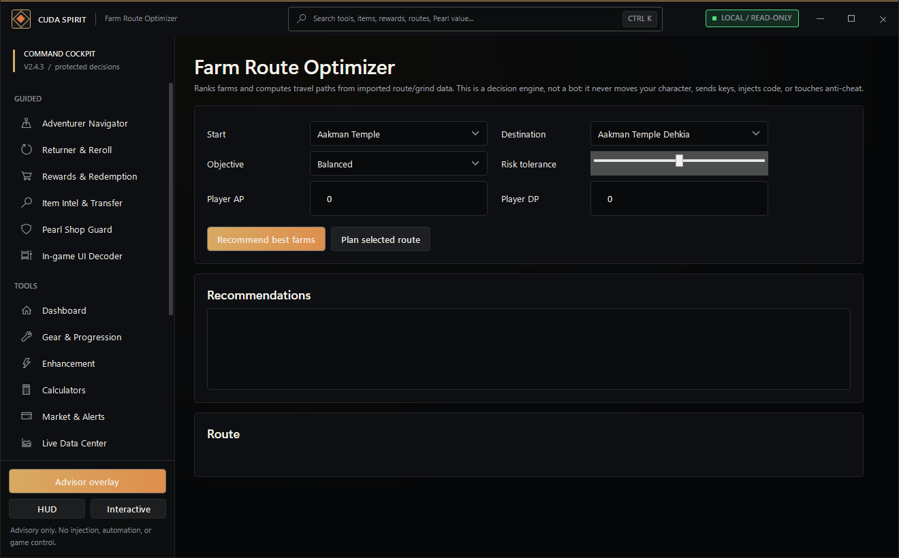
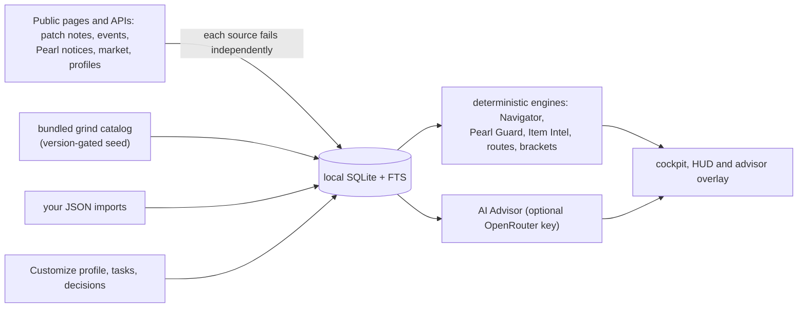

<div align="center">


[](https://github.com/SenjuWoo/Cuda-Spirit/actions/workflows/windows-release.yml)
[](https://github.com/SenjuWoo/Cuda-Spirit/releases/latest)
[](#install)
[](global.json)
[](LICENSE)

**[Install](#install)** · **[First ten minutes](#first-ten-minutes)** · **[Workspaces](#workspaces)** · **[Safety boundary](#safety-boundary)** · **[How it works](#how-it-works)** · **[Changelog](CHANGELOG.md)**

</div>

Cuda Spirit is a Windows companion for **Black Desert** players, built for the part of the game
that punishes uncertainty: scattered reward inboxes, binding rules, irreversible item choices,
deletion traps, and Pearl Shop offers that look better than they are. Deterministic safety engines,
a versioned local SQLite knowledge store, current public-source sync, returner recovery and optional
retrieval-grounded AI guidance sit behind one cockpit. Unknown or stale facts **fail closed** instead
of becoming confident guesses.

## What you get

- **Adventurer Navigator.** One persistent action queue with priorities, due dates, pins, completion and custom tasks, ranked so urgent rewards and irreversible risks rise above routine chores.
- **Returner & Reroll Recovery.** One-click returner rescue, an ordered recovery plan written into Navigator, and a seven-day **no-spend shield** so comeback excitement does not become a bad Pearl purchase.
- **Rewards & Redemption.** Coupons, Web Storage, Mail, Black Spirit's Safe, Challenges, attendance, passes, events and guild rewards, with binding warnings before you claim.
- **Item Intel and Transfer Lab.** Keep / store / transfer / unknown verdicts across storage, Magnus, maids, Family Inventory and the market warehouse.
- **Pearl Shop Guard.** Deterministic scoring for permanence, real discount, binding, randomness, free alternatives, duplication and your budget, plus the Thursday deal-rotation playbook.
- **Farm Route Optimizer and Gear & Progression.** A bundled, sourced catalog of 77 grind zones and 10 city hubs ranked by AP/DP fit, silver per hour, travel and risk, with the 2026 AP (100 to 449) and DP (203 to 401+) bracket tables.
- **Bosses & Events.** The NA/EU PC world-boss rotation converted from server time to yours, plus trackers and reset timers.
- **Live Data Center** (source health, freshness, imports, search), an optional **AI Advisor** (your own OpenRouter key), a click-through **HUD / advisor overlay** and a **Ctrl+K** command palette.




## Install

1. Download `Cuda-Spirit-<version>-Nexus.zip` from the [latest release](https://github.com/SenjuWoo/Cuda-Spirit/releases/latest).
2. Extract it anywhere outside Program Files.
3. Run `CudaSpirit.exe` (or `RUN CUDA SPIRIT.bat`). It is self-contained: no .NET runtime or SDK needed.

Needs 64-bit Windows 10 or 11. Microsoft Edge WebView2 (built into Windows 11) renders the official
pages used as a fallback source and the embedded browser.

Application data, which you should back up before replacing an older build:

```text
%APPDATA%\CudaSpirit\
  settings.json
  cudaspirit.db
  imports\
```

API keys live in `settings.json`; treat that file as a secret. Upgrading from an older version is
covered in [`UPGRADE_NOTES.md`](UPGRADE_NOTES.md).

## First ten minutes

1. **Customize**: set region, stage, focus, weekly hours, spending style, budget and owned conveniences.
2. Link a public adventurer profile on the Dashboard if you want auto-sync (optional).
3. **Returner & Reroll**: returning accounts press **One-click returner rescue**; new accounts follow the season path.
4. **Rewards** before opening boxes or consuming coupons.
5. Paste uncertain item tooltips into **Item Intel**, and use **Transfer Lab** before assuming an item is stuck.
6. Score every paid offer in **Pearl Shop Guard**.
7. Use **Navigator** as the only short list of what to do next. **Ctrl+K** answers questions like *"Can I move this outfit box?"* or *"Should I buy this Pearl bundle?"*

The full walkthrough, returner order and Pearl rules are in [`COCKPIT_GUIDE.md`](COCKPIT_GUIDE.md).

## Workspaces

| Group | Workspace | What it does |
|---|---|---|
| Guided | Adventurer Navigator | Ranked action queue, next best action, custom tasks |
| | Returner & Reroll | Recovery plan, returner rescue, no-spend shield, retirement checklist |
| | Rewards & Redemption | Every reward inbox and coupon path, with binding rules |
| | Item Intel & Transfer | Keep / store / transfer / unknown verdicts, transfer routes |
| | Pearl Shop Guard | Offer scoring, deal-rotation playbook, live official notices |
| | In-game UI Decoder | Says which screen, hotkey or hidden restriction you need, with a safer fallback |
| Tools | Dashboard | Profile auto-sync, gearscore, recommended grind spots |
| | Gear & Progression | Owned gear and bracket-aware next upgrades, season path |
| | Enhancement, Calculators | Enhancement cost per tap and cron use; marketplace tax after Value Pack and other bonuses |
| | Market & Alerts | Central Market alerts and how the 5-minute tick really resolves |
| | Live Data Center | Source health, freshness, imports, search |
| | Farm Route Optimizer | AP/DP-fit farm ranking and graph routing between nodes |
| | Bosses & Events, Trackers & Timers | World-boss rotation in local time, resets |
| | AI Advisor, Web & References | Source-attributed retrieval; official pages and guides |
| App | Customize, Technical Settings | Theme, density, startup page, progression profile, spending guardrails; OpenRouter key and model routing |

## Safety boundary

Cuda Spirit is a companion and decision-support app. It does **not** send keyboard or mouse input,
move or fight for the player, inject DLLs, manipulate packets, read process memory, alter the game
client, evade anti-cheat, install `.pak` files, or provide unattended gameplay.

The app cannot inspect the running game. A retirement "safe to delete" result proves that **you**
checked each risk, not that deletion is magically reversible. Cuda Spirit is not affiliated with
Pearl Abyss.

## How it works



- **Deterministic first.** Safety verdicts, Pearl scores, brackets and routes come from code and sourced data; the AI only explains on top of the same retrieved evidence.
- **Fail closed.** Stale or unknown facts are labelled as such; a source that fails never stops the others.
- **Your data stays local.** Network calls happen only for features you enable; sources are listed in [`DATA_SOURCES.md`](DATA_SOURCES.md) and [`PRIVACY.md`](PRIVACY.md).

### Honest status

Verified in this tree: the bundled catalog of 77 grind zones plus 10 city hubs (version-gated so
your imports are not overwritten), the 2026 AP and DP bracket tables, the NA/EU PC world-boss
rotation with server-timezone conversion, and `tools/CudaSpirit.Smoke` against a live temporary
SQLite database. CI runs the source validator, a warnings-as-errors build, a single-file publish and
a launch test that requires a real main window.

Not claimed: that the app can see hidden account state or the live client inventory, or that Pearl
Shop or market advice substitutes for the official UI.

## Build from source

Windows 10 or 11 x64 with any .NET 10 or newer SDK (`global.json` pins 10.0.100 and rolls forward
to newer majors; the release workflow uses 10.0.404).

```text
publish.bat                                       :: single-file publish, launch test, close
BUILD_NEXUS_RELEASE.bat                           :: self-contained Nexus package under artifacts\
python tools\validate_source.py                   :: source validator (clean tree), same as CI
dotnet run --project tools\CudaSpirit.Smoke -c Release   :: data-layer smoke test
```


More: [`TROUBLESHOOTING.md`](TROUBLESHOOTING.md), [`BUILD_STATUS.md`](BUILD_STATUS.md),
[`VALIDATION_REPORT.md`](VALIDATION_REPORT.md), [`data/README.md`](data/README.md).

## Credits

Sources for grind, market and Pearl notes are listed in [`DATA_SOURCES.md`](DATA_SOURCES.md).
Black Desert, Pearl Shop, and Pearl Abyss are trademarks of their owners. This project is unofficial.

## License

[MIT](LICENSE) · [Changelog](CHANGELOG.md)
